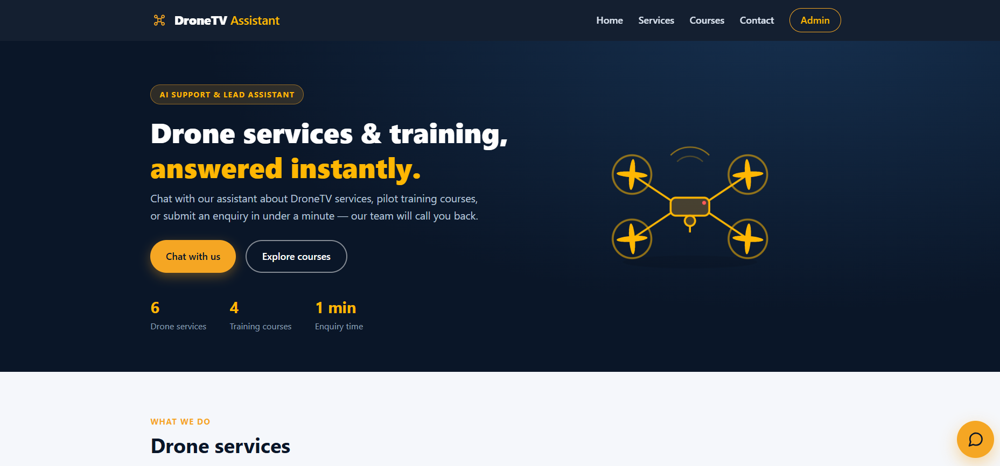
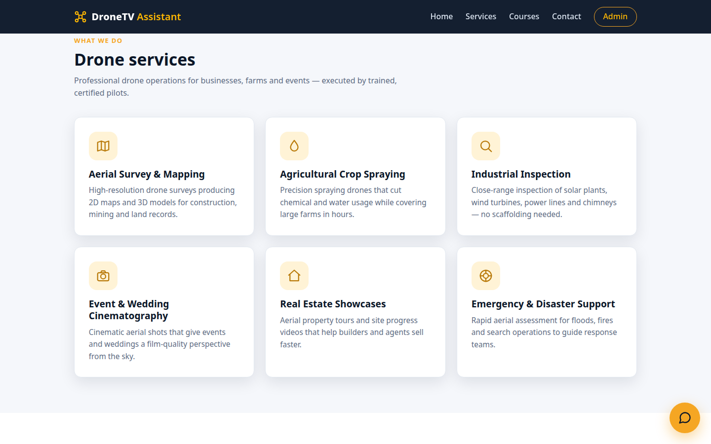
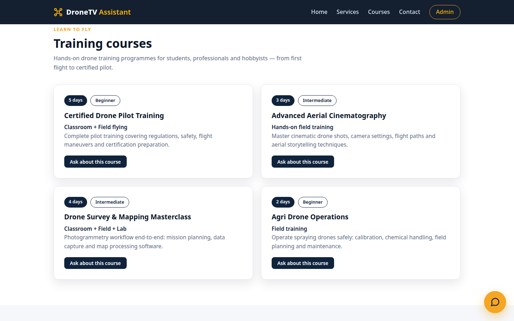
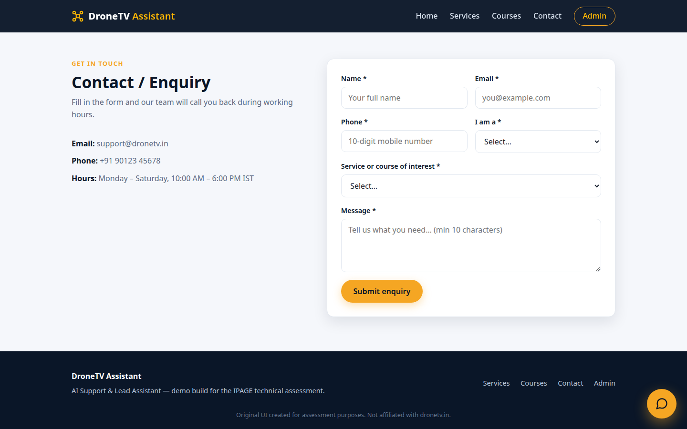
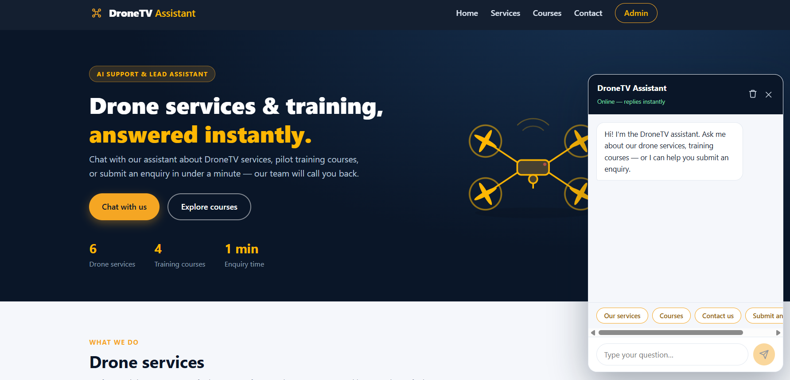
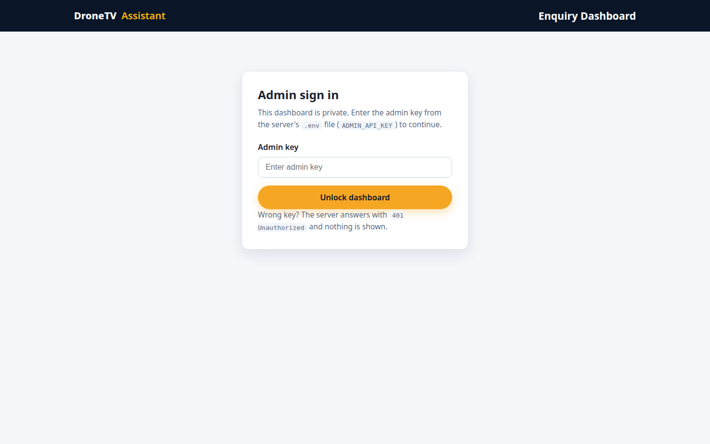
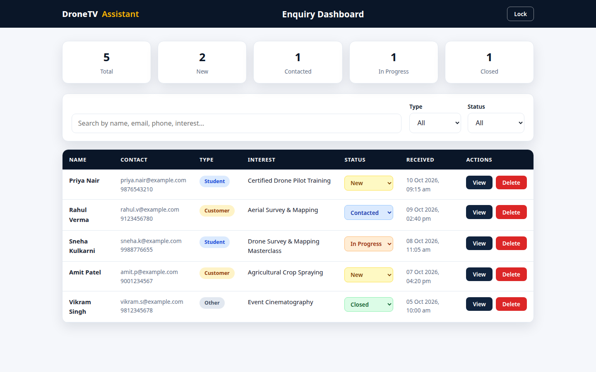

# DroneTV — AI Support & Lead Assistant

A full-stack web application built for the **IPAGE Group Full Stack Developer Internship
assessment**. It is an AI-style support and lead-capture assistant for a drone services &
training business ("DroneTV").

> **Note:** This is an original UI built for the assessment. It is not affiliated with
> dronetv.in. Contact details shown in the demo (support@dronetv.in, +91 90123 45678)
> are placeholders.

## Live Demo

- **Frontend:** https://client-plum-delta-75.vercel.app/
- **Backend API:** https://server-eu5i.onrender.com (health check: `/api/health`)
- **Demo admin key:** `AdminNameis0IPageGroup0` — enter it at `/admin` to unlock the dashboard.

> The backend runs on Render's free tier, which sleeps after ~15 minutes of
> inactivity — the first request after that can take 30–60 seconds to respond
> (cold start). If the dashboard says it can't reach the server, wait a few
> seconds and retry.

## What it does

- **Landing page** — drone services, training courses, contact/enquiry form (responsive).
- **Rule-based chatbot widget** (floating, every page) — answers questions about services,
  courses/training, contact info, registration, service interest, student enquiries, and
  speaking to a human; keeps session conversation history; has a clear/reset button;
  gracefully handles unknown questions; and runs a **guided enquiry flow** that collects
  name, email, phone, user type, service/course interest, and message, then submits it
  to the backend.
- **Admin dashboard** (`/admin`, key-protected) — view all enquiries, search by
  name/email/phone/interest/message, filter by Student/Customer and by status
  (New / Contacted / In Progress / Closed), change status, view full details,
  delete enquiries.
- **REST API + MongoDB** — full CRUD for enquiries with validation, sanitization,
  and error handling.

## Tech stack

| Layer    | Technology                              |
|----------|-----------------------------------------|
| Frontend | React 18 + TypeScript + Vite, React Router, plain CSS (responsive) |
| Backend  | Node.js + Express.js, Mongoose, express-rate-limit |
| Database | MongoDB (local or Atlas)                |
| Chatbot  | Rule-based engine (keyword matching, no external AI API needed) |

## Project structure

```
Source_Code/
├── client/                 # React + TypeScript frontend (Vite)
│   ├── src/
│   │   ├── api/client.ts       # API calls + admin-key handling
│   │   ├── chatbot/engine.ts   # rule-based chatbot brain
│   │   ├── components/         # Navbar, Hero, Services, Courses,
│   │   │                       # EnquiryForm, ChatWidget, Footer
│   │   ├── pages/              # Home, Admin (dashboard + login gate)
│   │   ├── CSS/                # one stylesheet per component + common.css
│   │   └── data/content.ts     # services / courses content
│   ├── vercel.json             # SPA rewrite: all routes → index.html (stops /admin 404 on refresh)
│   └── .env                    # VITE_API_URL (optional, defaults to localhost)
└── server/                 # Express API
    ├── src/
    │   ├── config/db.js        # MongoDB connection
    │   ├── models/Enquiry.js   # Mongoose schema
    │   ├── routes/enquiries.js # REST endpoints
    │   ├── middleware/
    │   │   ├── validate.js     # input validation + sanitization
    │   │   ├── adminAuth.js    # admin-key check (timing-safe) for management routes
    │   │   ├── adminRateLimit.js # rate-limits failed admin attempts (429)
    │   │   └── errorHandler.js # central error handler
    │   ├── utils/sanitize.js   # HTML stripping / trimming helpers
    │   ├── app.js              # Express app
    │   └── index.js            # DB connect + listen
    └── .env.example            # copy to .env and fill in
```

## Quick start

### 1. Database

You need MongoDB — either locally or a free cloud cluster:

- **Local:** install MongoDB Community and make sure it runs on
  `mongodb://127.0.0.1:27017` (default).
- **Atlas (cloud):** create a free cluster at cloud.mongodb.com → get the
  connection string → paste it as `MONGODB_URI` in `server/.env`.

No manual collection setup is needed — Mongoose creates the `enquiries`
collection automatically on first write.

### 2. Backend

```bash
cd server
npm install
cp .env.example .env
# Edit .env: set MONGODB_URI, CLIENT_URL, and ADMIN_API_KEY
# (pick any long random string for the admin key)
npm start
# API runs on http://localhost:5000
```

### 3. Frontend

```bash
cd client
npm install
# Optional: point the frontend at a deployed backend by creating a .env file:
# VITE_API_URL=https://your-api.onrender.com
# (defaults to http://localhost:5000, so local dev needs nothing)
npm run dev
# App runs on http://localhost:5173
```

Open http://localhost:5173 — the chatbot floats at the bottom-right of every
page. Open http://localhost:5173/admin and enter your `ADMIN_API_KEY` to
unlock the dashboard.

### Production build

```bash
cd client && npm run build   # outputs to client/dist/
```

## Deployment (free)

No code changes are needed to deploy — the API base URL, CORS origin, and
port are all environment-driven.

**Backend — Render (free tier)**

1. Push this repo to GitHub, then create a **Web Service** on render.com
   from the repo.
2. **Root Directory:** `01_Source_Code/server` · **Build Command:**
   `npm install` · **Start Command:** `npm start`.
3. Add environment variables: `MONGODB_URI`, `ADMIN_API_KEY`, `CLIENT_URL`
   (your frontend URL — set it after the next step).
4. Deploy — note the service URL, e.g. `https://dronetv-api.onrender.com`.

**Frontend — Vercel (free tier)**

1. Import the same repo on vercel.com as a new project.
2. **Root Directory:** `01_Source_Code/client` (the Vite preset is auto-detected).
3. Add the environment variable **before deploying**:
   `VITE_API_URL=https://dronetv-api.onrender.com` (your Render URL).
   Vite bakes this into the build, so changing it later needs a rebuild.
4. Deploy, then go back to Render and set `CLIENT_URL` to the Vercel URL.

Notes:

- MongoDB Atlas **Network Access** must allow the backend — `0.0.0.0/0`
  (allow from anywhere) is the simplest for a demo.
- Render's free tier sleeps after ~15 min of inactivity; the first request
  after that takes 30–60 s to wake the service (cold start).
- **Case-sensitive paths:** the stylesheet folder is `src/CSS/` (capital C)
  and every component imports from `../CSS/...`. Keep the case exactly as-is —
  Linux build servers (Vercel) fail with "module not found" if the folder is
  renamed to lowercase `css/`.
- **SPA routing on Vercel:** the app uses React Router, so a `vercel.json`
  containing `{ "rewrites": [{ "source": "/(.*)", "destination": "/index.html" }] }`
  must sit next to the client's `package.json`. Without it, opening `/admin`
  directly or refreshing the page shows Vercel's 404 page instead of the app.

## API endpoints

| Method | Endpoint              | Auth        | Purpose                              |
|--------|-----------------------|-------------|--------------------------------------|
| GET    | `/api/enquiries`      | Admin key   | List (search, userType & status filters) |
| GET    | `/api/enquiries/:id`  | Admin key   | Single enquiry                       |
| POST   | `/api/enquiries`      | Public      | Submit enquiry (form + chatbot)      |
| PUT    | `/api/enquiries/:id`  | Admin key   | Full update                          |
| PATCH  | `/api/enquiries/:id`  | Admin key   | Status update                        |
| DELETE | `/api/enquiries/:id`  | Admin key   | Delete                               |
| GET    | `/api/health`         | Public      | Health check                         |

Admin endpoints expect the key in the `x-admin-key` request header.
Without it the API answers `401 Unauthorized`. More than 100 failed admin
attempts from one IP within 15 minutes → `429 Too Many Requests`.

Full request/response details: see `03_API_Documentation/API_DOCUMENTATION.md`.
Database schema & setup: see `04_Database/DATABASE.md`.

## Validation, error handling & security (short version)

- **Validation** — every enquiry is checked on the server: all fields required,
  email must be a valid format, phone must be a 10-digit Indian mobile number,
  user type and status must be from fixed lists, text length limits enforced.
  Bad input → `400` with a clear per-field message.
- **Sanitization** — HTML tags are stripped from all text (blocks `<script>`
  injection), input is trimmed, phone numbers are normalized (`+91 98765 43210`
  → `9876543210`).
- **Error handling** — one central error handler: technical details are logged
  on the server, users only ever see safe, generic messages (no stack traces
  leak to the browser). Unknown routes → `404`, bad IDs → `400`.
- **Security** — CORS allows only the frontend origin; request bodies are
  limited to 100 KB; search input is escaped before use in RegExp (no ReDoS);
  enquiry management is locked behind the `ADMIN_API_KEY` (401 without it);
  the key is compared in constant time (timing-safe, so response timing can't
  leak it); failed admin attempts are rate-limited — 100 per 15 minutes per IP
  (`429` beyond that), which makes brute-forcing the key infeasible while
  normal dashboard use is never affected; secrets live in `.env`, which is
  never committed to git. To rotate the admin key, update `ADMIN_API_KEY` in
  `server/.env` and restart the server.

## Screenshots
<h3>Home Page</h3>

<h3>Services Section</h3>

<h3>Courses Section</h3>

<h3>Contact Section</h3>

<h3>Chatbot</h3>

<h3>Admin Page</h3>

<h3>Admin Dashboard</h3>

